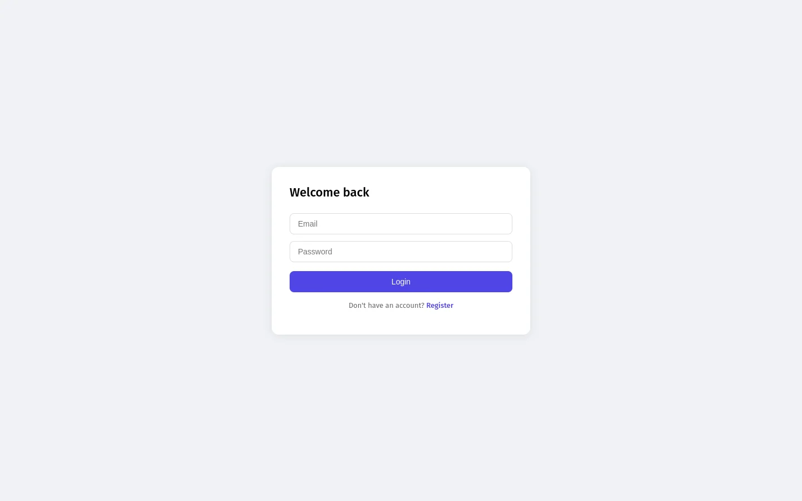

# MERN Stack Real-Time Chat App

A full-featured real-time chat application built with the MERN stack and Socket.IO.



## Features
- Real-time messaging with Socket.IO
- Public chat rooms
- Private direct messages (DMs)
- Online presence indicators
- Typing indicators
- Unread message badges
- Emoji reactions
- Image and file sharing (Cloudinary)
- User profiles with avatar upload
- Notification sounds
- JWT authentication

## Tech Stack
- **Frontend:** React, Socket.IO Client, Axios
- **Backend:** Node.js, Express, Socket.IO
- **Database:** MongoDB Atlas + Mongoose
- **Auth:** JWT + bcryptjs
- **File Storage:** Cloudinary

## Run Locally

### Backend
Create `server/.env`:

```bash
MONGO_URI=your-mongodb-connection-string
JWT_SECRET=a-long-random-string
PORT=5000
```

```bash
cd server
npm install
npm run dev
```

### Frontend
```bash
cd client
npm install
npm start
```

Open <http://localhost:3000>. The client expects the API at `http://localhost:5000`.
